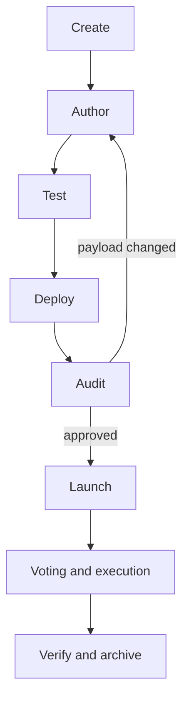

# Depot: design of the Lido governance vote tooling

Depot builds, tests and launches Lido governance votes on Mainnet and Hoodi. It rests on two ideas:

1. **One representation of a vote.** The calls are written once, as a Solidity vote contract. The contract an auditor reads returns the exact bytes the DAO votes on.
2. **Every later artifact is tied back to that contract.** The launched vote, the submitted DG proposals and the resulting protocol state are checked against it automatically.

The review of intent stays with people.

## Mechanism description

### The vote contract and the payload

Every vote is a Solidity **vote contract**, deployed before the vote is created. Depot creates the vote with exactly the script the contract returns, and the contract can confirm that a given vote is its own. CallsScript encoding is unambiguous, so comparing two scripts compares their calls.

A vote contract extends `OmnibusBase`:

- `getOmnibusCalls()` is implemented by the vote and returns the ordered **vote items**: `(title, target, payload)` per top-level call. Titles never enter the script; they form the vote description.
- `getEVMScript()` encodes the items into the script. It cannot be overridden.
- `isValidVoteScript(voteId)` compares the hash of the on-chain vote's script with the hash of `getEVMScript()`.

The smallest example, with imports and `using` directives omitted and comments added:

```solidity
contract TinyOmnibus is OmnibusBase {
    // Every address the vote touches is a named constant with its literal value in this file.
    address public constant VOTING = 0x2e59A20f205bB85a89C53f1936454680651E618e;
    address public constant FINANCE = 0xB9E5CBB9CA5b0d659238807E84D0176930753d86;
    address public constant LDO = 0x5A98FcBEA516Cf06857215779Fd812CA3beF1B32;
    address public constant RECIPIENT = 0x0000000000000000000000000000000000000777;
    uint256 public constant VOTE_ITEMS_COUNT = 1; // size of the top-level builder
    uint256 public constant PAYMENT_AMOUNT = 10_000 ether;
    string public constant ITEM_TITLE = "Transfer 10,000 LDO to test address";

    constructor() OmnibusBase(VOTING) {} // isValidVoteScript reads this Voting

    function getOmnibusCalls() public pure override returns (VoteCall[] memory) {
        return VoteCallsBuilderUtils.create(VOTE_ITEMS_COUNT) // reserve exactly 1 item
            .newImmediatePayment(ITEM_TITLE, FINANCE, LDO, RECIPIENT, PAYMENT_AMOUNT, ITEM_TITLE)
            .getCalls(); // reverts unless exactly 1 was added
    }
}
```

#### Building calls

Calls are assembled with builders, one per level at which a call is made:

| Builder                 | A child is                        | Called by             |
| ----------------------- | --------------------------------- | --------------------- |
| `VoteCallsBuilder`      | a vote item                       | Voting                |
| `ProposalCallsBuilder`  | a call of a DG proposal           | the DG admin executor |
| `ForwardedCallsBuilder` | a call inside one `Agent.forward` | the Agent             |

Builders encode calls and grant nothing: the author picks the level by who holds the permission on the target. A DG proposal is a vote item that calls `submitProposal(calls, metadata)`; the `metadata` string is an argument of the call, so it is part of the payload the DAO votes on. There is no helper for Voting to forward through the Agent directly.

Each builder is created with a fixed **size**, the number of its immediate children, and `getCalls()` reverts unless exactly that many were added. A forgotten or duplicated call therefore makes the contract unusable instead of producing a payload that still looks plausible.

```
vote
└─ item 1: DualGovernance.submitProposal(calls, metadata)    VoteCallsBuilder, size 1
   ├─ call 0: Agent.forward                                  ProposalCallsBuilder, size 2
   │  └─ ACL.grantPermission(...)
   └─ call 1: Agent.forward
      ├─ Kernel.setApp(...)                                  ForwardedCallsBuilder, size 2
      └─ ACL.revokePermission(...)
```

Domain libraries add typed helpers on top of the builders for the Agent, Dual Governance, Finance, Easy Track, allowed recipients, permissions, Kernel and node operators.

#### Vote description

The on-chain vote description is not written by hand. Depot builds it from the item titles, numbered by position, and appends a link to the public vote text:

```
Omnibus vote: 1. Transfer 10,000 LDO to the Example multisig;
 2. Submit a Dual Governance proposal to raise the SDVT stake share limit.
https://bafkrei...ipfs.dweb.link
```

Titles must be non-empty and unique and must not start with an item number such as `1.` or `2)`. The link carries the content hash of `<name>.ipfs.md`, which is uploaded to IPFS at launch, so neither the description nor the text can change afterwards.

#### The omnibus folder

- `<name>.md`: the author's specification, the intended actions and the exact text of each DG proposal.
- `<name>.ipfs.md`: the public vote text.
- `Omnibus_<name>.sol`: the vote contract.
- `<name>.ts`: the wrapper with the tests, an optional custom `deploy()`, and the recorded `deployment.omnibus` and `voteId`. It contains no calls.

#### Payload checks

| Check                 | Compared                                                                                          | When                                              |
| --------------------- | ------------------------------------------------------------------------------------------------- | ------------------------------------------------- |
| DG metadata           | `metadata` of each `submitProposal` item against its text in `<name>.md`, character for character | every test, trace, multi-test and launch          |
| Source vs. deployment | script and titles of a fresh local build against the recorded contract                            | fork runs of a recorded default deployment        |
| Launched script       | on-chain vote script against `getEVMScript()`                                                     | after launch; test and archive of a launched vote |
| Launched description  | on-chain description against the one rebuilt from titles and `<name>.ipfs.md`                     | test and archive of a launched vote               |
| Submitted proposals   | on-chain `getProposalCalls(id)` against the calls in the contract                                 | test of an enacted vote                           |

A failed check stops the command.

### Vote lifecycle

A vote goes through eight steps, led by its **pilot**, the person responsible for it. Depot sends public transactions in two of them, deploy and launch, and only with `--broadcast`; without it both are **rehearsals** that run on a local fork and record nothing.



| Step                 | Command                              | Done by                            | Result                                              |
| -------------------- | ------------------------------------ | ---------------------------------- | --------------------------------------------------- |
| Create               | `omnibus:create`                     | pilot                              | scaffold of the four files                          |
| Author               | —                                    | pilot, optionally with an AI agent | description, vote contract, tests                   |
| Test                 | `omnibus:test`, `omnibus:multi-test` | pilot, agent, CI                   | green fork run                                      |
| Deploy               | `omnibus:deploy --broadcast`         | pilot                              | vote contract on chain, address recorded            |
| Audit                | —                                    | reviewer other than the author     | deployed contract confirmed against the description |
| Launch               | `omnibus:launch --broadcast`         | pilot                              | Aragon vote created, `voteId` recorded              |
| Voting and execution | —                                    | DAO                                | vote enacted, DG proposals executed                 |
| Verify and archive   | `omnibus:test`, `omnibus:archive`    | pilot                              | on-chain result checked, omnibus archived           |

Depot records progress in two wrapper fields: `deployment.omnibus` after deploy and `voteId` after launch. On-chain progress is never stored: every command reads it from the chain, so the repository cannot claim a state the chain contradicts.

#### Create and author

`omnibus:create` asks for the network, the name and whether the vote upgrades the protocol, and copies the template into `omnibuses/ongoing/<network>/<name>/`.

Authoring happens by hand or with an AI agent. An unfinished draft cannot pass as a finished one: the builder reverts until the declared number of calls is added, and the DG metadata check fails until the contract and `<name>.md` agree.

#### Test

`omnibus:test` runs the vote on a fork and writes `<name>.evm-script.hex`, the script the vote will execute, for review diffs. `omnibus:multi-test` runs the suites of the code-owning repositories on the post-vote fork.

Several votes of one network can be in progress at once. They are ordered by folder name (`yyyy_mm_dd[_suffix]`), and each is tested on top of the earlier ones through `--after`. CI does this automatically; the last vote in order is the **candidate**.

Test, trace, multi-test and launch start with the same **preparation**, which obtains the vote contract and runs the payload checks:

1. `deployment.omnibus` is recorded: the recorded contract is used. On a fork Depot also builds the local source and requires the same script and titles. The comparison is by script, not bytecode, so a change in a shared library that leaves the script intact does not invalidate a deployment. Omnibuses with a custom `deploy()` are not compared.
2. `voteId` is set without a deployment: refused. A launched vote is tested against its real contract, never a fresh local one.
3. Neither: the contract is compiled and deployed on the fork. On a real network this is refused.

#### Deploy

`omnibus:deploy <name> [--broadcast]` deploys the vote contract. It follows a green `omnibus:test` on the same source.

- **Refused** when a deployment is already recorded, or when the default deployment does not find exactly one `.sol` with a zero-argument constructor. With `--broadcast` it is also refused when the address could not be written into the wrapper; this is checked before any transaction, so a deployment cannot succeed on chain and then fail to be recorded.
- **Recorded** after a broadcast: Depot writes `deployment.omnibus` into the wrapper source. For a custom `deploy()` it prints the block for the pilot to paste.

#### Audit

Audit is the review of the deployed contract against `<name>.md`: every address, amount, route and item order. No command performs it. The launch rehearsal supports it by printing every item (title, target, calldata), the vote description and the public text.

If the payload changes after the audit, fork runs fail on the source comparison. The author either restores the source, or removes `deployment` from the wrapper, redeploys and has the new address audited again. A broadcast launch always uses the recorded contract, so a local edit cannot reach the vote.

#### Launch

`omnibus:launch <name> [--broadcast]` creates the Aragon vote.

**Refused** when `voteId` is already set, or when `<name>.ipfs.md` is missing, empty or still the template. The text check applies to rehearsals too, because the text cannot be corrected after launch. With `--broadcast` it is also refused without a recorded deployment, or when `voteId` could not be written into the wrapper.

Steps:

1. Prepare the omnibus.
2. Build the vote description from the titles and the locally computed content hash of `<name>.ipfs.md`.
3. Print the items, the description, the public text and the script.
4. Select the pilot's account and print its address, nonce, ETH and LDO balances.
5. After confirmation, with `--broadcast`, upload the public text to IPFS.
6. Send one transaction: `TokenManager.forward` wrapping `Voting.newVote(script, description, false, false)`, which any LDO holder can do. `voteId` is read from the `StartVote` event.
7. With `--broadcast`, write `voteId` into the wrapper.
8. Call `isValidVoteScript(voteId)` and fail if the created vote's script differs from the contract's.

#### Voting and execution

Depot takes no part in voting, enactment, or the scheduling and execution of DG proposals. `omnibus:test` can be run at any point of this step and tests the vote from where it is on chain.

#### Verify and archive

After execution, `omnibus:test` on a recent block compares the on-chain script, description and DG proposal calls with the contract, and runs `testFinalState` and the acceptance checks against the current state.

`omnibus:archive <name>` reads the real network and sends nothing. It moves the folder to `omnibuses/archive/<network>/` when all of the following hold:

- `voteId` and `deployment.omnibus` are recorded;
- `isValidVoteScript(voteId)` is true and the on-chain description equals the one built from `<name>.ipfs.md`;
- the vote is finished: enacted with every DG proposal executed or cancelled, or closed without passing.

A vote with pending DG proposals stays in `ongoing/`, where CI keeps testing it until its last effect is on chain.

#### Broadcasting

Deploy and launch sign with a **keystore**, an encrypted private key kept outside git. With `--broadcast` Depot asks for the keystore password and for the network name typed in full, and prints each transaction hash before sending. Without `--broadcast` the key is never decrypted: Depot impersonates the account on a local fork, because a transaction signed for a fork could be replayed on the real network.

AI agents may author, test and rehearse a vote, but never broadcast and never read keystore contents. This is a rule for agents, not a code check; in practice it rests on the keystore password and the interactive prompts.

### Testing a vote on a fork

`omnibus:test <name>` executes the vote on a fork of its network through the real governance contracts. A green run means that:

1. the payload checks pass;
2. the vote and every DG proposal it submits execute;
3. every emitted event is matched by an expectation, and the author's state assertions and the acceptance checks hold afterwards.

#### Fork

Depot uses a node already listening on the local RPC port, or starts an in-process fork at `--fork-block` (latest by default). A reused node is never reset: it must be at the requested block and its latest block hash must match the real chain, otherwise the run fails.

`--after a,b` applies earlier ongoing votes first, in order, each with all its DG proposals and without running its tests.

Everything runs inside EVM snapshots that are reverted when the task ends, also on failure. Nothing is reverted between callbacks, so a probe made in `testVote` remains visible in `testProposal`, `testFinalState` and acceptance.

#### Stages

What has not yet happened on chain is executed on the fork and checked in full. What has already happened is not replayed: it is compared with the contract and checked in its resulting state.

| Stage        | Executed on the fork                | Callbacks                                    | Compared with chain                 |
| ------------ | ----------------------------------- | -------------------------------------------- | ----------------------------------- |
| not launched | new vote, all DG proposals          | `testVote`, `testProposal`, `testFinalState` | —                                   |
| voting       | the existing vote, all DG proposals | `testVote`, `testProposal`, `testFinalState` | script, description                 |
| DG pending   | pending DG proposals                | `testProposal`, `testFinalState`             | script, description, proposal calls |
| executed     | nothing                             | `testFinalState`                             | script, description, proposal calls |

A fork block before the launch, a rejected vote or a cancelled DG proposal fails the run.

#### Callbacks

The wrapper defines three callbacks. `testVote` receives `passOmnibus()` and `testProposal` receives `passProposals()`; each must call it, so that the before-state reads and the after-state assertions sit in one function around the execution and a test can assert a change, not only an end value. The optional `testFinalState` asserts the state the whole vote leaves and is the only per-vote check of an already executed vote.

- **`passOmnibus()`** creates the vote from an impersonated account the way a real launch does, votes "yes" with impersonated LDO holders, advances time by `voteTime` and enacts. A real pending vote is passed the same way; in its objection phase Depot relies on the real tally.
- **`passProposals()`** moves time past the DG delays and past an active Veto Signalling, then schedules and executes each proposal. Any DG state other than Normal or Veto Cooldown at that point fails the run. It can be called with a subset of ids to assert an intermediate state; when `testProposal` returns, every submitted proposal must have been executed.

Callbacks also receive `checks`, a set of reusable assertions for ACL permissions and OZ roles, Easy Track factories, staking modules and node operators, and token balances.

#### Event check

Every log of the execution transactions must be matched by exactly one expected event, in order, or the run fails. A state assertion checks only what the author thought to check. An unexpected side effect, such as a role granted to the wrong account or a second transfer, surfaces as a log nobody expected.

The author lists the **domain events** per vote item and per proposal call:

```ts
const { voteEvents } = await passOmnibus();
voteEvents.item(title, [
  /* events of this item, in emission order */
]);

const [proposal] = (await passProposals()).proposalEvents;
proposal.call(0, [
  /* events of this call */
]);
proposal.call(1, [
  [
    /* nested call 1 */
  ],
  [
    /* nested call 2 */
  ],
]); // Agent forward with two calls
```

Depot adds the **envelope** itself, the events that surround every item regardless of its content: `LogScriptCall` and `ScriptResult` of Voting and of the Agent, both `ProposalSubmitted` events of a submitting item (with the calls and metadata from the contract), `Executed` per proposal call, and the closing `ExecuteVote` and `ProposalExecuted`. The envelope events also split the receipt into one window per item, so a log can only match an expectation of its own item.

A log matches when the emitter, the event signature and every specified argument are equal. An argument given as `null` is not compared, so the precision of the check is the precision of the expectations.

The run fails on a missing event, a mismatched event, a log left unmatched, an item or proposal call that was not registered, and a proposal that was not executed.

#### Related tasks

`omnibus:trace <name>` passes the vote and its proposals on a fork and prints the call tree with emitted logs, with proxy, view and structural noise removed. The author uses it to write event expectations, a reviewer to spot unintended calls. `omnibus:pass-aragon-vote <network> <voteId>` passes a pending vote on a running local node and leaves it in the post-vote state for manual inspection.

### Protocol-level verification

Per-vote tests are written by the vote's author and show that the vote did what was intended. Three further layers look for what the author did not think about. Each takes its expectations from somewhere other than the vote.

#### Acceptance checks

Mocha suites in `test/protocol/acceptance/` assert the configuration of the deployed protocol: proxy implementations and admins, versions, linked addresses, role holders, limits and parameters of the core contracts, staking modules, oracles, withdrawal contracts, Dual Governance and the circuit breaker. Three negative suites drive real oracle consensus and withdrawal flows and require invalid reports and requests to revert with the exact error.

- **When.** By default in every `omnibus:test`, after the vote, all DG proposals, the event checks and `testFinalState`. For a vote already executed on chain they check the state at the fork block. `--skip-acceptance` turns them off, for example on a historical fork block where current expectations do not hold.
- **Expectations.** Per-network literals inside each suite, taken from deployment artifacts and executed votes. They are never read back from the getter under test and import nothing from the vote, so a vote cannot make its own acceptance pass.
- **Intentional changes.** When a vote changes a checked value, the expectation is edited in the same change, from an independent source.
- **Registration.** The runner fails on a suite file that is not listed in `ACCEPTANCE_SUITES` and on a run that collects no tests, so a suite cannot silently stop running.

#### Upgrade snapshots

Some effects of an upgrade cannot be written down as expected values: the result of a deposit, a transfer or a voting round through a new implementation. For these Depot runs a fixed scenario twice from the same state, without the vote and after it, and requires every recorded view result and storage word to be equal.

- **Switch.** `upgrade: true` in the wrapper runs all suites in `test/protocol/snapshot/`; the author neither selects suites nor declares differences.
- **Suites.** Lido (views, transfers, deposits, staking controls), a plain submit, DSM, Node Operators Registry, a full Voting round, and raw storage slots 0–15 of 22 contracts. Implementation pointers lie outside those slots, so the new implementation address is asserted in the per-vote tests.
- **Allowed differences.** Code inside the suite, next to the comparison: absolute tolerances (for example 2 wei on `getPooledEthByShares`), fields excluded by a rule, and scenario rules. They are edited from the intended effect of an upgrade, never from an observed diff.
- **Run.** After a clean `omnibus:test` pass, each case re-runs the whole vote in its own snapshot: reference scenario, revert, vote and all DG proposals with event checks, the same scenario, comparison.
- **Completeness.** The run fails if no case ran, a case is pending, a case finished without executing the vote, or a comparison failed. A suite cannot pass by being skipped.
- **Not applicable** once the Aragon vote is executed on chain: there is no pre-vote state left for the reference run.

#### Multi-test

`omnibus:multi-test` runs the fork suites of the repositories that own the protocol code against a fork on which the vote has been executed: `core`, `dual-governance`, `staking-modules`, `stonks`, and the regression tests of `scripts`. Each repository is built in Docker at a commit resolved at the start of the run.

- Depot applies the `--after` votes and the vote itself, each with all its DG proposals. None of the vote's own checks run here.
- Repositories run one at a time, each inside its own snapshot, so each starts from the same post-vote state. A failed suite fails the task.
- Only `core` has a Hoodi suite; on Hoodi the others are skipped.

### CI

On every pull request:

- **Checks.** Security scan, Prettier, `forge fmt --check`, ESLint, `tsc`.
- **Tooling tests.** Depot unit and integration tests (in-process Hardhat, no RPC) and the Solidity library tests of the call builders (`forge test`, no fork).
- **Vote test.** For each network, `omnibus:test` for every vote in `ongoing/<network>/` in name order, each on top of the earlier ones.
- **Post-vote regression.** For each external repository, `omnibus:multi-test` for the network's candidate, with the fork pinned to the `finalized` block and the repository commit resolved once per job.

The last two need RPC secrets and are skipped for pull requests from forks; the regression is also skipped for drafts. A network without ongoing votes has nothing to run.

### Verification layers summary

| Layer                 | Question                                                                              | Source of expectations                           | Cannot catch                                                    |
| --------------------- | ------------------------------------------------------------------------------------- | ------------------------------------------------ | --------------------------------------------------------------- |
| Payload checks        | Is the voted script the one the reviewed source produces, with the reviewed DG texts? | Vote contract, `<name>.md`, on-chain vote        | A reviewed source that is itself wrong                          |
| Per-vote state checks | Did the vote make the intended changes?                                               | Vote author                                      | Unanticipated side effects; an error shared by payload and test |
| Per-vote event checks | Did execution emit exactly the expected events?                                       | Vote author plus Depot's envelopes               | Wrong state behind correct-looking events                       |
| Acceptance            | Is the deployed protocol still configured as recorded?                                | Per-network literals, independent of the vote    | Behaviour changes that keep configuration; values not listed    |
| Upgrade snapshots     | Does the protocol behave the same in fixed scenarios?                                 | The pre-vote run of the same scenario            | Unscripted paths; changes within tolerances                     |
| Multi-test            | Do the owners' fork suites pass on the post-vote state?                               | Upstream repositories                            | Anything outside those suites                                   |
| Human review          | Are addresses, parameters, texts and intent right?                                    | Governance proposal, official deployment sources | Whatever is not checked                                         |

## What is left to people

- **Intent.** Whether the calls, amounts, order and grouping are what the DAO means to do. No tool parses the action list in `<name>.md`; a reviewer other than the author reconciles each item with its call.
- **Addresses.** A wrong but valid address passes every automatic check. A reviewer confirms each address constant against an official source.
- **Texts.** Whether the titles, the DG metadata and the public vote text describe the payload truthfully.
- **Expectations.** Per-vote tests are written by the author of the payload, so an error present in both passes.
- **The real vote.** A fork run says nothing about whether the real vote reaches quorum or how DG behaves under a veto.

## Design decisions

- **Calls are written only in Solidity.** The vote contract is the only description of the calls, so there is one thing to review. TypeScript runs, deploys and tests the vote but never assembles its payload.
- **Per-vote tests are written in TypeScript.** The fork harness and the event comparison are TypeScript, and expected values are test data that must not be deployed inside the vote contract.
- **Acceptance checks live in Depot.** The repositories that own the protocol code test its logic on fresh deployments and mocks. That cannot show that the live instance is configured as intended after a vote, and no other repository checks it.
- **Vote addresses are explicit.** Every address a vote uses is a named constant with its literal value in the vote's own file, even when it exists in Depot's shared registries. A reviewer sees the address next to the call that uses it. No tool can tell whether an address is the intended contract, so this is enforced by review.
